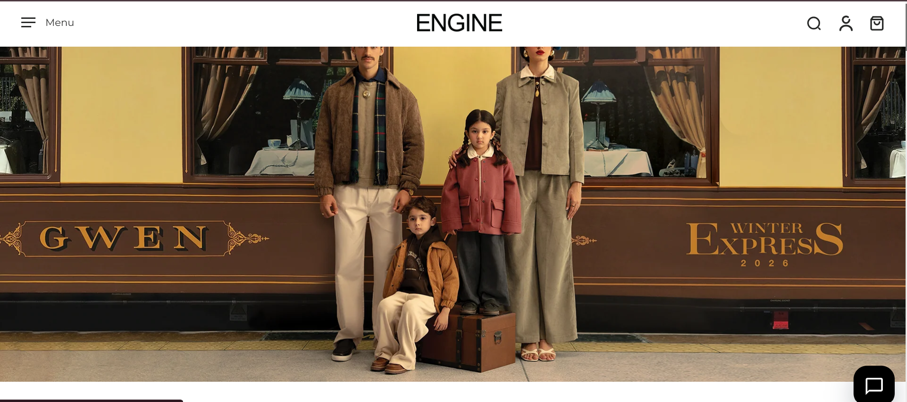
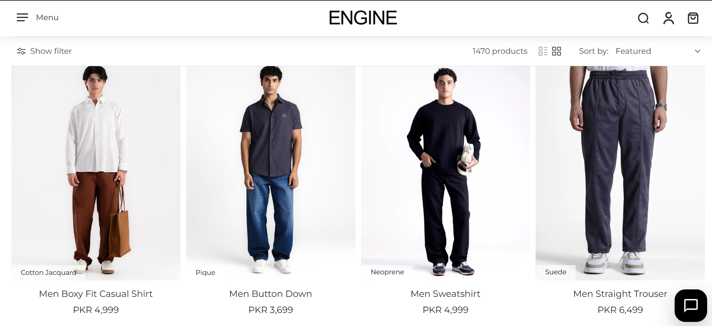
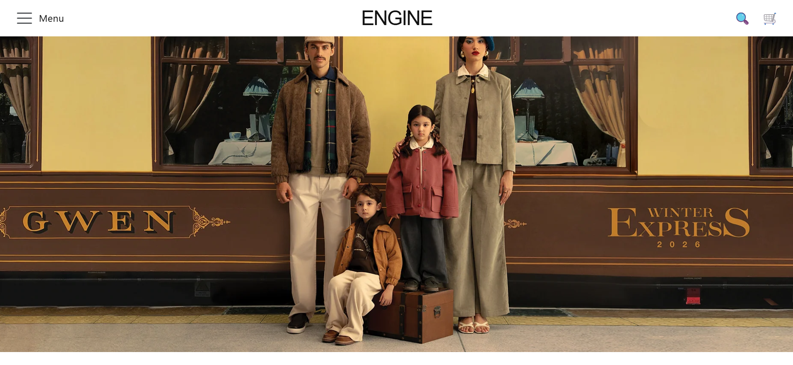
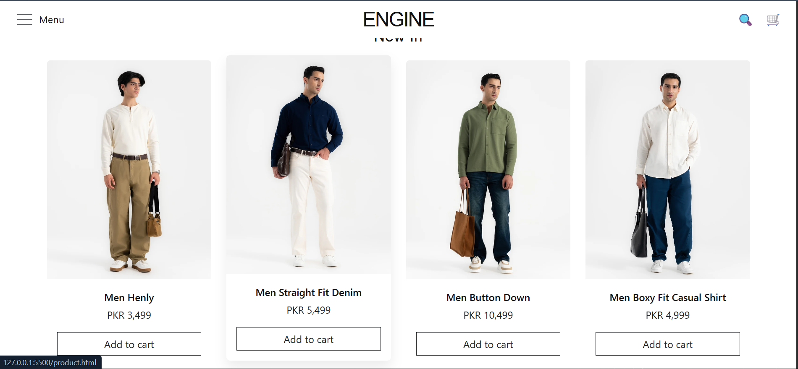
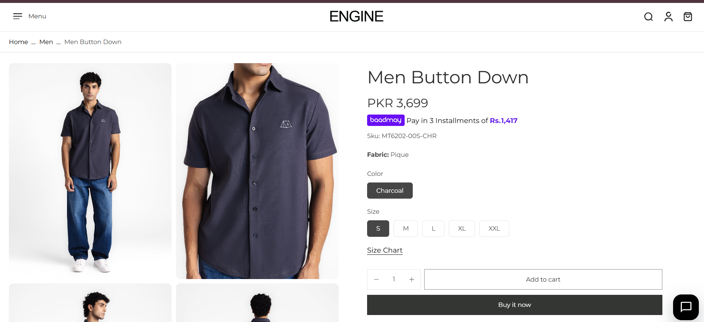
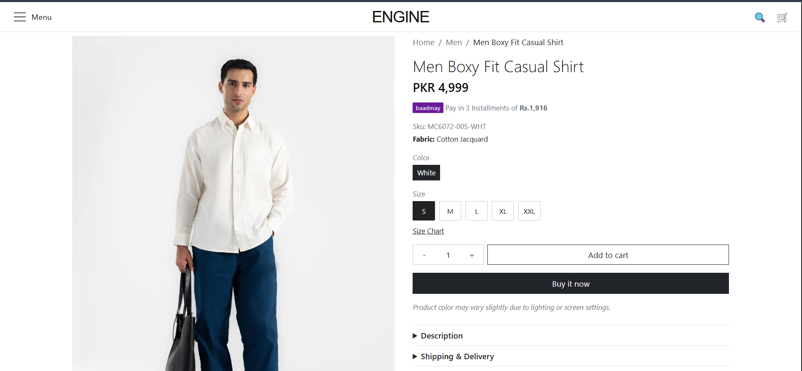

# Engine (Men's Wear) – Web Development Assignment 2

## Reference Website

- **Name:** Engine
- **URL:** https://engine.com.pk/

### Reference homepage screenshot

1.

2.

### My homepage

1.

2.

### Reference Product Details Page

### My Product Details Page

## Pages

- `index.html` – product listing
- `product.html` – product details

## Built with

HTML, CSS, Bootstrap 5.3.8, Bootstrap Icons
